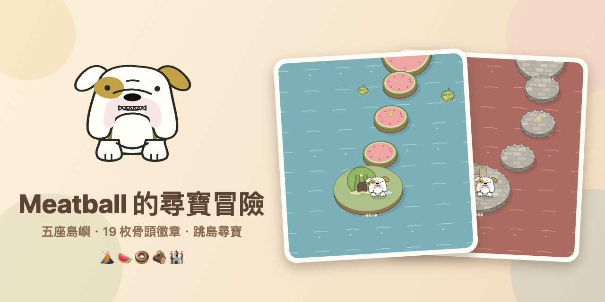
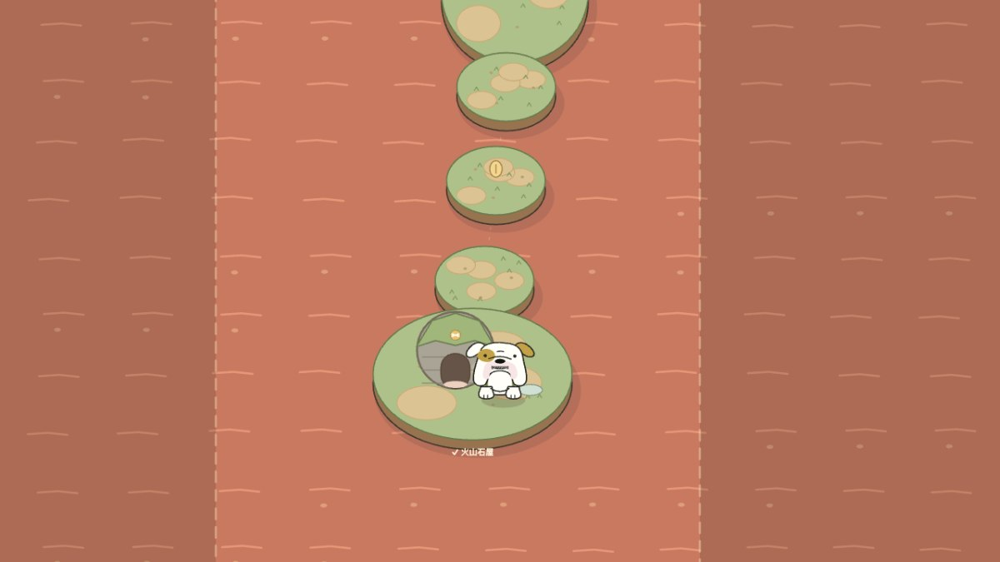
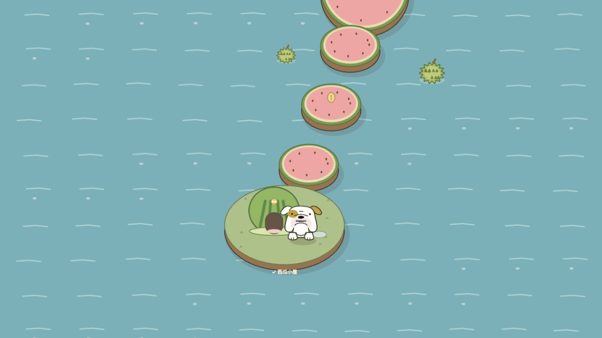
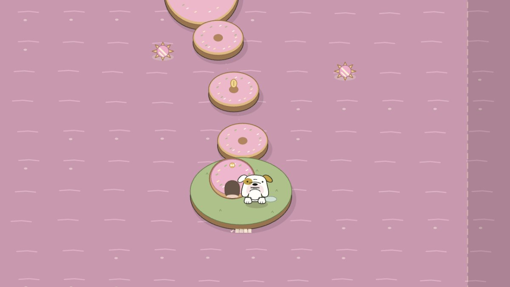
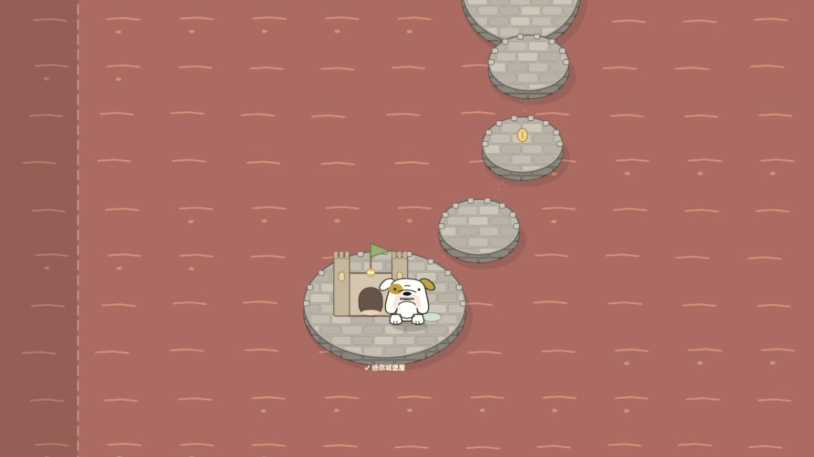

# Meatball 的尋寶冒險 🐶🦴

白色金斑鬥牛犬 Meatball 的跳島尋寶小遊戲——單一 HTML 檔案、零相依套件，打開就能玩。

## 🎮 立即遊玩

👉 **[點這裡直接開玩](https://riorio1996.github.io/meatball-adventure/)**，或下載後雙擊 `index.html`。

## 📸 遊戲畫面

| 🌋 岩漿小島 | 🍉 西瓜漂浮灣 |
|:---:|:---:|
|  |  |

| 🍩 甜甜圈樂園 | 🏰 岩漿終點城堡 |
|:---:|:---:|
|  |  |

## 🗺️ 遊戲內容

- **五座主題島嶼**：岩漿小島（入門緩彎）、西瓜漂浮灣（蜿蜒河灣）、甜甜圈樂園（圈圈迴旋）、熔岩木棧道（棧道折返）、岩漿終點城堡（城垛方波），每關路線形狀各異
- **19 枚主題材質骨頭徽章**：黑曜石骨、西瓜紅徽奶油骨、巧克力徽薄荷糖霜骨、鐵件藍徽金骨、城堡紅旗象牙骨
- **機關與障礙**：移動島、裂痕平台、彈跳平台、大範圍巡游的榴槤與尖刺、忽大忽小的障礙物與漩渦
- **狗屋存檔點**：進狗屋補滿生命，續玩從最近啟用的狗屋出發

## 🕹️ 操作方式

| 操作 | 說明 |
|---|---|
| 點擊小島 | 跳躍（距離不限） |
| 空中再點一下 | 二段跳 |
| 方向鍵／WASD | 移動 |
| 空白鍵 | 跳躍與二段跳 |
| E／Q | 下一座島／徽章岔路 |
| F | 進狗屋 |
| P／Esc | 暫停 |

## ✨ 技術特色

- 純前端：HTML + Canvas 2D + Web Audio API，無任何外部資源
- 每關柔和主題音樂與所有音效皆由程式即時合成
- 遊戲進度、最高分、徽章與暱稱透過 localStorage 儲存在玩家瀏覽器
- 內建榜單頁面（此版本為本機榜單，儲存於各自瀏覽器）
- 支援手機觸控與鍵盤操作、深色提示、減少動態偏好

## 📄 授權

個人作品，歡迎遊玩與學習。
